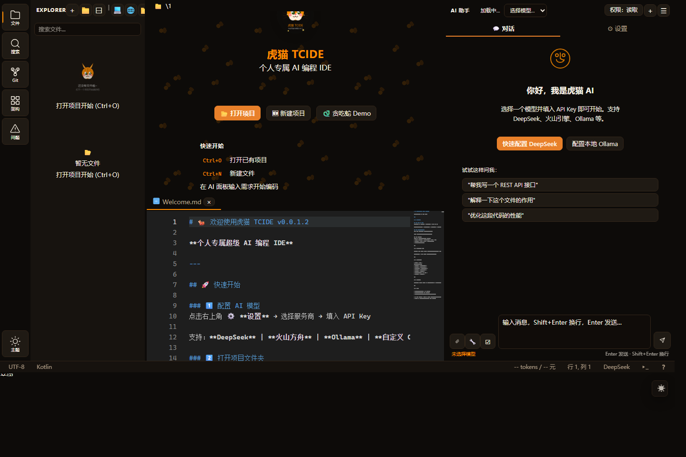
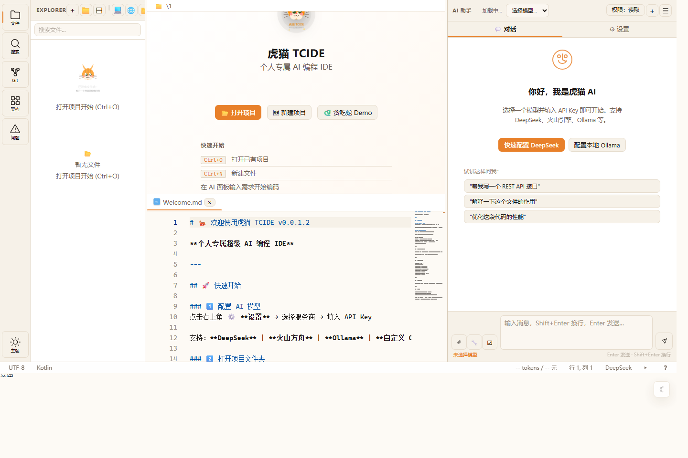

# 虎猫 TCIDE

[](LICENSE)

本地跑的 AI 编程 IDE。后端是 FastAPI，窗口用 PyWebView，编辑器是 Monaco。前端资源全部随包分发，断网也能打开。

它和"在编辑器右边塞个聊天框"不太一样：智能体在项目里读代码、改文件、跑命令，每一步都留下可审的痕迹；写操作默认要你点过才生效。



浅色主题同一套配色改成暖白底，右下角的按钮切换，也可以加 `?theme=light`：



## 安装

需要 Python 3.10 以上。

从源码装：

```bash
pipx install .        # 或者 pip install .
tcide
```

或者下发布包。wheel 里已经带了构建好的前端，装完直接能开界面：

```bash
pip install tcide-0.0.1.3-py3-none-any.whl
tcide
```

`sdist` 里额外含前端源码（`src/`、`vite.config.ts`），可以自己重建。

## 首次运行：先配模型

打开侧栏的设置面板，切到 AI 标签，填服务商、模型名和 API Key。配置写在 `%APPDATA%\tcide\settings.json`（macOS/Linux 在各自的配置目录），也可以直接编辑这个文件。MCP 服务器列表在同一个目录的 `mcp.json`。

权限默认是逐次确认：写文件、执行命令之前会把改动摆出来，你点了才动。面板顶部有个常驻的权限档按钮，可以在只读 / 逐次确认 / 自动之间切。只读档下写操作是真的被拒绝，不是弹个提示。

## 命令行参数

| 参数 | 作用 |
|---|---|
| `tcide [项目目录]` | 打开指定目录，省略则用当前目录 |
| `--browser` | 用系统浏览器打开，不开原生窗口 |
| `--no-window` | 只跑后端服务，无界面（适合放到服务器或 CI 里） |
| `--no-pet` | 不显示桌面宠物 |
| `--port` / `--host` | 服务监听地址，默认 `127.0.0.1:18420` |

## 能做什么

编辑器部分是常规配置：文件树、多标签、Monaco 的补全跳转格式化、内嵌多实例终端、Git 的 status/diff/commit/push/pull/branches。

智能体这块是重点：

- Builder 把需求拆成任务，Coder 并行实现，Reviewer 把关；审查不通过会带着理由重试
- 同一个需求可以让它在几份隔离副本里各做一遍，按完成率和测试结果挑一份提交（best-of-N）
- 长任务有检查点。中断之后能看到哪些任务已完成、哪些工具的结果还没结算，不会糊里糊涂重跑
- MCP：接上外部工具服务器之后，那些工具直接进工具表，模型能调用；它们一律按危险工具处理，只读档下会被拦
- LSP：诊断、补全、跳转、格式化

另外还有上下文记忆（自动识别技术栈与编码风格）、TF-IDF + BM25 的语义检索、文件快照与回滚、token 与成本统计。

## 桌面宠物

一只虎猫浮在桌面上，跟着会话状态换动作：待机、埋头干活、打盹、出错。可以拖到屏幕任意位置，下次打开还回到那儿；闲置几分钟它会自己睡。不想要就加 `--no-pet`。

美术是手画的矢量图，导出成透明 PNG 和会动的 GIF 放在 `web/icons/pet/`。改图改 `web/icons/pet/tcide-pet.svg`，然后跑 `python tools/render_pet_bitmaps.py` 重新导出。

## 目录结构

```
main.py            入口：起后端线程，开 PyWebView 窗口（含宠物窗口）
server.py          FastAPI 应用与路由挂载
api/               HTTP 层：files / git_ops / terminal / ai / lsp / mcp / memory ...
tcide_core/        核心逻辑：工作区、工具注册表、权限、agent、diff、检查点、LSP 客户端
agents/            builder / coder / reviewer / orchestrator
adapters/          模型适配（OpenAI 兼容 / Anthropic / Ollama）
src/renderer/      前端源码（Vite + Monaco + xterm）
web/               构建产物，随包分发；宠物页面也在这一层
static/            主题覆盖层与切换脚本
tools/             自检脚本与构建、发布辅助
tests/             pytest 用例
```

## 开发

```bash
python -m pytest -q                 # 全量测试
python tools/verify_install.py      # 在干净 venv 里真装真跑
python tools/verify_lsp.py          # 接真 pyright，验证能拿到真诊断
python tools/verify_mcp.py          # 接真 MCP server，验证工具能被调用
python tools/verify_release.py      # 校验发布产物内容，并真的装一遍
python tools/api_audit.py           # 前端调用的接口与后端路由对账
python tools/readme_style.py        # 发布文档风格检查
```

前端改完不能只在本机跑：`src/renderer/` 需要 Vite 构建成 `web/`，而构建产物是提交进仓库的。CI 里有个 `frontend` 工作流负责构建，本地拉取用：

```bash
python tools/sync_frontend_from_ci.py
```

它会比对产物里的提交号与当前 HEAD，不一致就拒绝同步。

## 已知问题

- LSP 开箱只有 Python 能用（装 `pyright` 即可）。其他语言要自己装对应的服务器，界面会给出安装命令。
- Monaco 的浅色主题是一套手工对齐的独立定义，因为 Monaco 的主题 API 只认具体色值，不认 CSS 变量。改主题颜色要同时改 `main.css` 和 `main.ts` 里的 `trae-light`。
- 冻结打包（PyInstaller 之类）在开发机上不可用：冻结后的 PySide6 在 `QApplication()` 处崩溃（`0xC0000005`），已确认与项目本身无关。要安装请走 pip。排查记录在 `docs/DEFECT_TRIAGE.md`。
- 启动时偶尔会冒出一个上下文菜单，还没查到原因。

## 许可

LGPL-3.0-only，仅第 3 版，不含 "or any later version"。各源文件头部带 SPDX 标识。

`web/assets/vendor-*` 是第三方资源，保持原授权：xterm.js 与 Monaco 都是 MIT。

## 致谢

虎猫的配色和主题来自桌面端 PawUI 版；桌面宠物的做法参考了 [MollyPaw](https://github.com/LK-BLOG/MollyPaw)。编辑器与终端分别来自 Monaco Editor 和 xterm.js。

## 分支

| 分支 | 说明 |
|---|---|
| `main` | 当前主线 |
| `tcide-py` | 与 main 同内容的开发分支，CI 会校验两者一致 |
| tag `archive/electron-v0.0.9` | 旧的 TypeScript + Electron 版本，已归档 |
