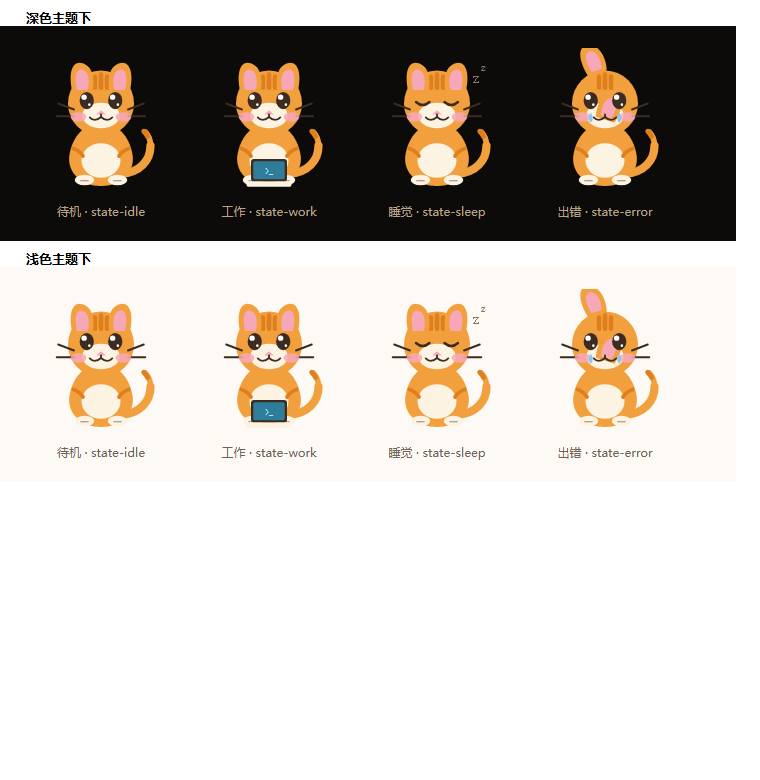

# 虎猫宠物：设计说明

## 为什么换

原来的宠物是**程序化生成的像素画**（`tcide_core/pet.py` 生成帧数据 +
`pet_manifest.json`，前端在 canvas 上画）。渲染出来一看，问题很具体：

| | 原宠物 | 品牌插画（`web/icons/brand/welcome-illustration.png`） |
|---|---|---|
| 风格 | 像素画，MS Paint 时代感 | 扁平矢量 |
| 眼睛 | 纯黑圆点，**无高光** | 有高光，有神 |
| 细节 | 无腮红，虎纹只在肚子上 | 腮红、额头虎纹、胡须 |
| 比例 | 头圆身**方**，尾巴是折线 | 圆润统一 |
| 轮廓 | 粗细不一致 | 干净 |

结论：**丑的根因不是"画得不够细"，而是"程序化生成"这种方式本身**。项目已经有
一套好的视觉语言（品牌插画），宠物却不在其中 —— 放在一起像两个产品。

## 向 MollyPaw 学到的

参考 [MollyPaw](https://github.com/LK-BLOG/MollyPaw)（同样是 Python + PyWebView）：

```
assets/pet/pet_idle.png   pet_work.png   pet_sleep.png   pet_cry.png
```

它做对了三件事，与本项目的问题正好对应：

1. **每个状态一张成品图** —— 不靠程序生成。**这是最要紧的一条。**
2. **状态与 Agent 真实状态同步** —— 宠物是"现在在干什么"的指示器，不是装饰。
3. **颜色来自角色本身**（棕色+白色来自那只泰迪的毛色）—— 视觉与身份一致。

本项目沿用这三条原则，但**没有照搬它的实现形式**（它是独立 tkinter 进程、四张位图；
我们的宠物在界面里，用 SVG + CSS 动画更合适：任意尺寸清晰、深浅主题都能自适应）。

## 现在的做法

`web/icons/pet/tcide-pet.svg` —— **手绘平面矢量**，沿用品牌视觉语言：

- 颜色：橙身 `#F2A03D` / 虎纹 `#DE7F1E` / 奶油脸腹 `#FDF3E3` / 粉腮红 `#F7A8B8` /
  轮廓用深棕 `#3B2B20`（比纯黑柔和）
- **大眼睛 + 双白色高光**（可爱主要靠这个）、腮红、胡须、额头三道虎纹
- 状态用**类名**切换，动画交给 CSS：`.state-idle` / `.state-work` / `.state-sleep` /
  `.state-error`（并遵守 `prefers-reduced-motion`）

四个状态的**静图差异**（不只是动画差别 —— 这是第二轮发现的坑）：

- 待机：睁眼微笑，轻微呼吸起伏，尾巴慢摆
- **工作**：亮出**小笔电**（蓝屏 `>_`）并快速打字式起伏 —— 一眼可辨，也贴合"编程伙伴"
- 睡觉：闭眼 + 冒 `z`，节奏放慢
- 出错：耳朵下垂 + 落泪

## 三轮迭代（每轮都渲染成图、看过再改）

这不是"画一次就完"：每改一版都用无头 Edge 渲染成图（`.tcide-sync/render_pet_preview.py`，
深浅两种背景 × 四状态），**用眼睛验收**后再改。改掉的坑：

1. **第一轮**：尾巴是根粗橙条像胳膊；耳朵画在头**后面**被盖住；身体太宽像仓鼠；
   肚子上的条纹像肚皮上的胡须；**"工作"与"待机"静图完全一样**。
2. **第二轮**：耳朵挪到头**上面**并放大（带粉色内耳）；"工作"加小笔电；
   收窄上半身做出肩线。留下：尾尖的深色**圆点**像挂了个球；出错状态把尾巴转到头顶，
   变成一根悬空灰弧。
3. **第三轮**：尾巴改成**两段粗细递减**（根部粗、末端细，深色收尾）；出错状态不再动尾巴；
   前后爪画到身体之上、落在下缘，能看见。



## 还没做（接手请从此处继续）

- **尚未接入应用** ✗：界面里的宠物仍是原来的 canvas 像素实现。SVG 目前是独立文件，
  需要替换 `src/renderer/main.ts` 里的宠物绘制代码。
- **状态映射未做完** ✗：应用现有的状态比这四个多（`idle` / `thinking` / `tool` /
  `success` / `error` / `review` / `run` / `jump` / `wave` / `failed`），需要建立
  完整映射（例如 `success` 可加"星星眼"、`tool` 可复用工作态）。
- **未在真实界面里验收** ✗：目前只在预览页里看过，还没有在应用的状态栏里
  （那里尺寸更小、背景是深色）确认过可读性。
